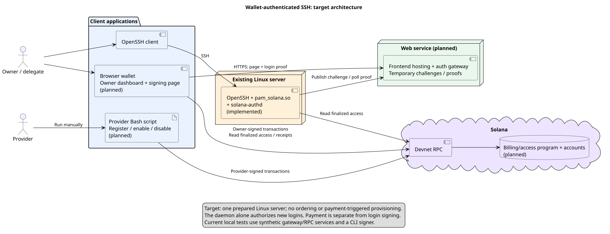
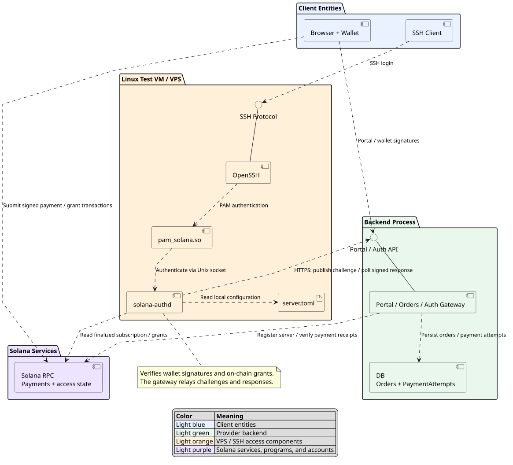
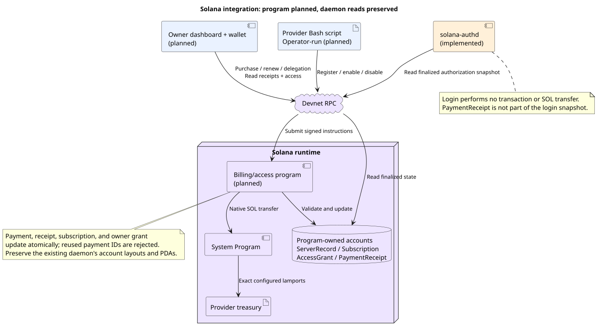
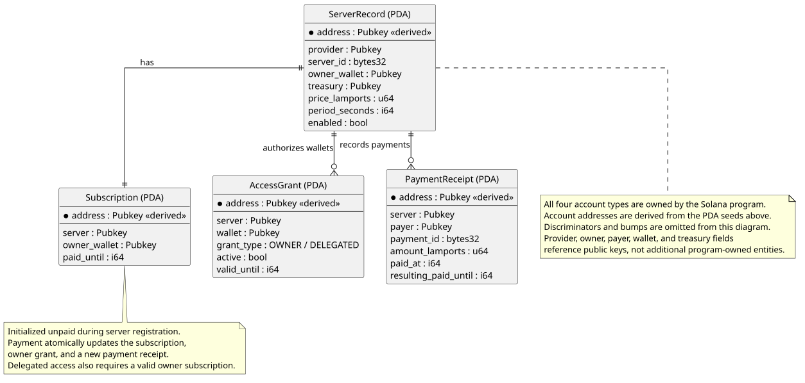
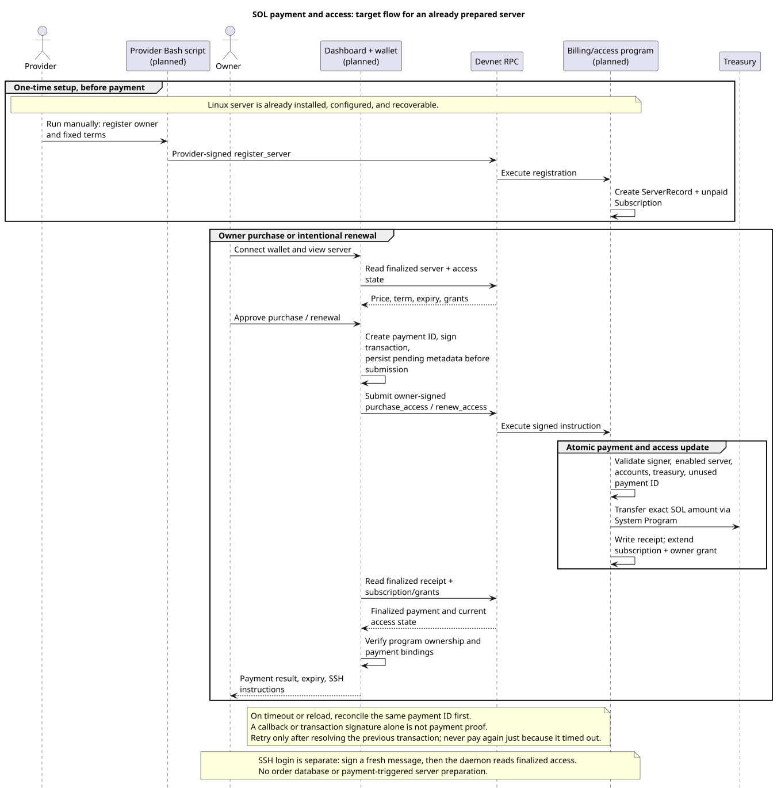
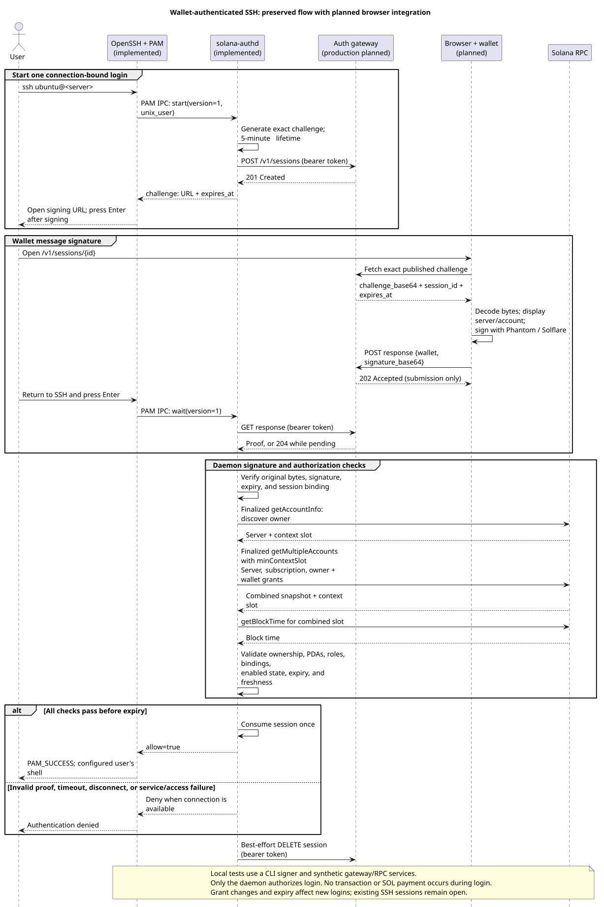
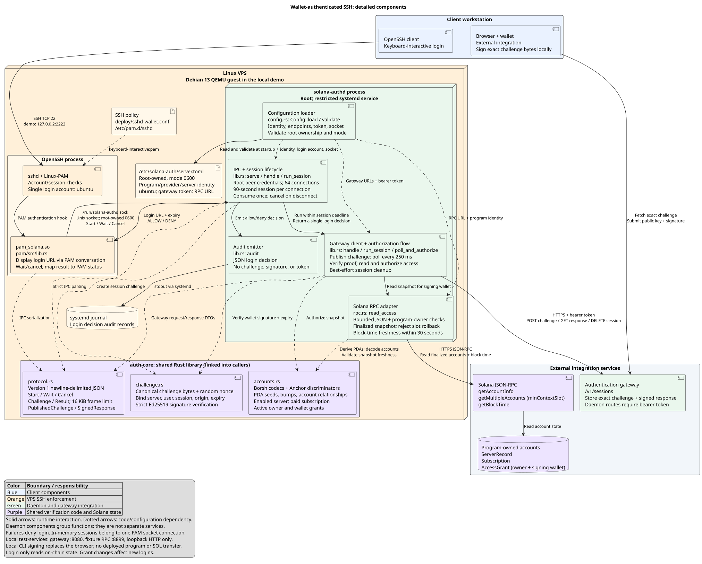
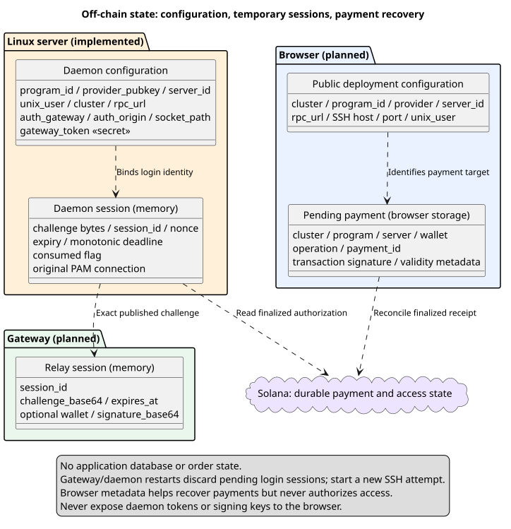

# Solana Wallet Authentication for SSH

**Status:** working PAM/daemon authentication, Axum gateway, browser signing page, billing/access program, provider Bash script, owner dashboard, and local tests; devnet deployment and real-wallet HTTPS/devnet integration planned.

**Integrated target:** one existing Debian 13 VM, Solana devnet, native SOL, and the configured non-root Linux account (`ubuntu` in the demo).

**Compatibility baseline:** [authentication contract v1](ssh/CONTRACTS.md) and the existing Rust implementation.

This is a solo-developer project centered on signing in to an existing Linux server with a Solana wallet. The remaining product work adds paid access and a small owner interface around the implemented authentication.

## Contents

- [Scope and current state](#scope-and-current-state)
- [Components](#components)
- [Server setup and identity](#server-setup-and-identity)
- [On-chain state and instructions](#on-chain-state-and-instructions)
- [Payments and recovery](#payments-and-recovery)
- [Wallet authentication through SSH](#wallet-authentication-through-ssh)
- [Authorization and expiry](#authorization-and-expiry)
- [Local state and operations](#local-state-and-operations)
- [Testing and acceptance](#testing-and-acceptance)
- [Solo-developer roadmap](#solo-developer-roadmap)

Diagrams show the target architecture unless marked as the existing implementation. Their [PlantUML sources and rendering instructions](docs/diagrams/README.md) accompany the SVGs.

## Scope and current state

The owner pays for access to a server that the provider has already prepared and registered. The owner can renew access or delegate it to other wallets. During SSH login, an owner or delegate signs a short-lived message using Phantom or Solflare; the daemon checks the signature and on-chain authorization.

| Component | Current state |
| --- | --- |
| PAM module, daemon, and shared verification library | Implemented under `ssh/` |
| Debian 13 QEMU/OpenSSH harness | Implemented, using synthetic gateway/RPC services and a command-line signer |
| Solana billing/access program and provider Bash script | Implemented under `programs/`. Tested on LiteSVM against the auth-core decoder, and on a local validator through the daemon's RPC reader; not yet deployed to devnet |
| Production gateway and browser signing page | Implemented locally; browser tests use provider doubles with real signatures; HTTPS and installed-wallet integration remains manual |
| Owner payment/access dashboard | Implemented in `frontend/` and served by the gateway; browser tests drive it against the program on a local validator with real signatures |

Keep the current authentication code and its tests. New components must fit the existing PAM IPC, gateway API, signed bytes, account layouts, and PDA seeds. The contract remains provisional until real program/gateway integration is tested.

The product excludes VPS ordering, inventory, automated provisioning, order tracking, a provider administration UI, a dedicated provider CLI, and an application database. Docker is not required; [compose.yaml](compose.yaml) optionally runs the gateway and frontend. Existing VM preparation scripts remain useful test tooling; payments never trigger VM preparation. General-purpose PAM integration beyond the current SSH use case is outside the first version.

## Components



[PlantUML source](docs/diagrams/system-overview.puml)

| Component | Responsibility |
| --- | --- |
| Owner dashboard | Connect a wallet; show the price and availability to everyone, and expiry, shared access, payment history, and the SSH command only to wallets entitled to them; submit purchase, renewal, and delegation transactions through RPC after a confirm step |
| Browser signing page | Display login context and sign the daemon's exact challenge; available to owners and delegates |
| Authentication gateway | Serve the frontend and relay temporary challenges/proofs over HTTPS; no access decisions |
| Provider Bash script | Manually register a prepared server for sale with fixed terms; enable/disable the server using the provider's signature |
| Solana billing/access program | Transfer native SOL atomically with receipts and subscription/owner-grant updates; enforce delegation |
| `solana-authd` | Create sessions, verify signatures and finalized account state, and return allow/deny |
| `pam_solana.so` | Display the login URL through PAM, communicate over the protected Unix socket, and return the daemon's decision to OpenSSH |

The gateway is one small service with in-memory login sessions. The browser and provider Bash script submit signed transactions through RPC; the gateway has no billing, registration, or provisioning API.



[PlantUML source](docs/diagrams/off-chain-components.puml)

The daemon only reads Solana state during login. Program instructions, SOL transfers, and provider operations happen separately.



[PlantUML source](docs/diagrams/on-chain-components.puml)

## Server setup and identity

Prepare one existing server before offering paid access. Install OpenSSH, Linux-PAM, the module, and the daemon; configure gateway/RPC connectivity and clock synchronization; verify independent console recovery.

Generate a stable 32-byte `server_id`. Its identity is bound to the configured program and provider, not to an IP address:

```text
(program_id, provider_pubkey, server_id) -> ServerRecord PDA -> configured Linux server
```

Use [the existing configuration example](ssh/deploy/server.toml.example) for root-owned mode-0600 `/etc/solana-auth/server.toml`. It includes the program/provider/server identity, `unix_user`, RPC URL, gateway transport URL, public signing origin, bearer token, and socket path. Keep `commitment = "finalized"`, the 300-second challenge lifetime, and `local_test = false` for devnet. Browser input cannot select another server identity or Linux account.

The default account is `ubuntu`; the daemon rejects root login. Preserve the installed OpenSSH/PAM account/session checks and the wallet-only authentication policy in [the deployment artifacts](ssh/deploy/). Follow [SSH installation and recovery guidance](ssh/README.md), including `sshd -t`, before enabling the policy.

A simple operator-run Bash script registers the server for sale with a treasury and a fixed positive SOL price and period, and handles enable/disable operations. Keep it as a small setup/maintenance script using the selected program tooling; do not build a separate provider CLI application for the MVP. The provider keeps its signing keys; neither the gateway nor the owner dashboard receives them. Supply the dashboard with non-secret server identity and SSH connection details through deployment configuration.

## On-chain state and instructions

[The program](programs/billing-access/README.md) preserves the first three accounts exactly as decoded by [auth-core](ssh/auth-core/src/accounts.rs); [contract v1](ssh/CONTRACTS.md) defines their field order, discriminator, Borsh encoding, bumps, and role values.

| Account | Purpose | PDA seeds |
| --- | --- | --- |
| `ServerRecord` | Provider, server ID, current owner (all-zero until bought), treasury, price, period, enabled flag | `server`, provider public key, server ID |
| `Subscription` | Server, owner, and paid-until timestamp | `subscription`, server record address |
| `AccessGrant` | Server, wallet, OWNER/DELEGATED role, active flag, and expiry | `grant`, server record address, wallet public key |
| `PaymentReceipt` | Server, payer, unique payment ID, amount, paid-at time, resulting paid-until time | `payment`, server record address, payment ID |

Payment IDs are unique 32-byte values. Receipt encoding and instruction definitions are published in [the program IDL](shared/billing-access/billing_access.json); the daemon does not consume receipts during login.

```text
Provider-signed, through an operator-run Bash script:
  register_server(server_id, treasury, price_lamports, period_seconds)
  set_server_enabled(enabled)

Buyer-signed, through the dashboard:
  purchase_access(payment_id)

Owner-signed, through the dashboard:
  renew_access(payment_id)
  grant_delegated_access(wallet, valid_until)
  revoke_delegated_access(wallet)
```

Registration creates the server with no owner (the all-zero key) and an unpaid subscription. Any wallet may purchase a server that has no owner or whose subscription has expired; the buyer becomes the owner in both the server record and the subscription, and the new term starts at purchase time. The previous owner's grant and its delegates' grants already ended with the old term, so they keep no access and the previous owner can no longer renew or delegate. While a term runs, only its owner can pay, by renewing, and renewal remains available to that owner after expiry until another wallet buys. Both payments validate accounts and signers, reject disabled servers and reused payment IDs, and transfer the exact configured lamport amount to the recorded treasury. In the same transaction, set `paid_until = max(paid_until, Clock.unix_timestamp) + period_seconds` with checked arithmetic, create/update the active owner grant to that expiry, and write the receipt. Failure rolls back the transfer and all access updates.

Delegation changes require an enabled server and an active, unexpired owner subscription/grant. Reject attempts to modify the owner grant through delegation instructions or to grant beyond the subscription term. Delegates cannot manage access or act as the owner. Renewal extends the owner grant; delegated grants retain their explicit expiry until updated by the owner.



[PlantUML source](docs/diagrams/on-chain-entities.puml)

## Payments and recovery

The owner dashboard reads the configured server's finalized record and displays its price, term, subscription expiry, and SSH instructions. The owner signs a purchase or renewal transaction with a fresh payment ID; the browser submits it through RPC. No order or server-preparation workflow is involved.

Display a successful payment only after verifying the finalized program-owned receipt and its server, payer, payment ID, amount, and resulting expiry, together with the matching subscription state. Show current access separately from payment history: an old valid receipt does not prove an unexpired subscription or an active grant. A browser callback, a submitted transaction signature, or a standalone SOL transfer cannot establish paid access.

Before submission, persist non-secret pending-operation metadata in browser storage, keyed by cluster/program/server/wallet: the operation, payment ID, and signed transaction signature/validity information. Reconcile after reload, reconnect, timeout, or a lost response:

1. Check the expected receipt and transaction status through RPC. A valid finalized receipt proves that operation completed; refresh the displayed subscription/grants without paying again.
2. If the result remains pending or uncertain, keep the same payment ID and show a pending state. Do not create a replacement payment to resolve a timeout.
3. Rebuild/re-sign only after establishing that the previous transaction failed or expired without execution and that no receipt exists. Reuse the same payment ID for the same operation; on-chain uniqueness prevents a duplicate charge.
4. If browser metadata is lost or another device is used, recover receipt/transaction history for that wallet and server before retrying an uncertain payment. Browser storage is a recovery aid; Solana remains the authority.

A later intentional renewal uses a new payment ID. There is no scheduled debit or automatic wallet signing.



[PlantUML source](docs/diagrams/billing-and-provisioning.puml) (the existing filename is retained; the flow contains no provisioning)

## Wallet authentication through SSH

The user runs `ssh ubuntu@<server>`; the existing local harness uses `ssh -p 2222 ubuntu@127.0.0.2`.

1. OpenSSH invokes PAM. The module sends the requested Linux account over the root-only daemon socket.
2. The daemon creates a fresh, connection-bound 5-minute challenge, publishes it through the authenticated gateway API, and returns the signing URL.
3. PAM displays the URL and a compact terminal QR code for the same URL. The user opens or scans it, connects Phantom or Solflare, and signs the exact bytes decoded from `challenge_base64`.
4. The browser submits `{wallet, signature_base64}` to the gateway. It reports submission and tells the user to return to SSH and press Enter; submission is not an authorization decision.
5. The daemon polls the proof, checks signature/session validity and finalized access state, consumes a successful session once, and returns allow/deny through PAM.

Preserve the existing `VPS-ACCESS-AUTH/1` message prefix and field order, including its trailing LF; the project rename does not rename the protocol. Login signs a message, incurs no transaction fee, and does not transfer SOL. See [contract v1](ssh/CONTRACTS.md) for the exact bytes, IPC frames, and gateway payloads/status codes.

The emitted signing URL is `/v1/sessions/{id}`. The production gateway should serve the browser view for HTML requests while retaining the existing JSON representation for API clients. Keep bearer-authenticated publication, polling, and cleanup; public challenge retrieval and proof submission; one immutable response per live session; and the existing expiry/duplicate errors. Never send the daemon token to the browser.



[PlantUML source](docs/diagrams/ssh-login.puml)

The detailed component diagram describes the existing PAM/daemon code. Its local external services remain fixtures. The Axum gateway and browser signer are implemented; installed wallets, HTTPS, and a deployed program still need integration.



[PlantUML source](docs/diagrams/ssh-components.puml)

## Authorization and expiry

The daemon uses finalized `getAccountInfo` to discover the owner, then finalized `getMultipleAccounts` for the server, subscription, owner grant, and signing wallet's grant. It requires at least the discovery slot and revalidates the owner in the combined snapshot. Validate program ownership, executable/lamport metadata, encoding/discriminators, PDA bumps, roles, and all wallet/server bindings.

Allow a new login only if the signature is valid for this unused, unexpired session and the configured Linux account matches; the server is enabled; the owner's subscription has not expired; and both the owner grant and signing wallet's appropriate OWNER/DELEGATED grant are active and unexpired. The daemon is the sole login decision maker.

Use the synchronized VM clock for login expiry and the program's Clock sysvar for on-chain changes. The combined RPC slot's block time must be within 30 seconds of the VM clock. Invalid/stale/unavailable RPC data, gateway failures, disconnects, malformed IPC, and timeouts fail closed. No cached-access or RPC-error fallback is permitted.

Expired subscriptions/grants deny new logins without a cleanup transaction. Revocation or server disablement takes effect for new logins when the change is finalized and observed by the daemon.

Access also ends logins that are already open. The daemon records each allowed login's per-connection `sshd-session` process, which it finds through the PAM client's peer credentials, together with the wallet and the earliest of the subscription and grant expiries. It warns the login's terminal a minute before that deadline and terminates the login's logind session at the deadline, which also ends processes left running in the background. Every 60 seconds it re-reads finalized access state for open logins: revocation, server disablement, or a new owner ends them, and renewal moves the deadline. If that state cannot be read, the known deadline still applies. A login whose `sshd-session` process cannot be identified is denied. Open logins are saved under `/run`, so a daemon restart keeps enforcing them.

## Local state and operations

Keep durable access and payment state on Solana. The gateway stores only short-lived challenges/proofs in memory; the daemon keeps connection-bound sessions in memory. Gateway or daemon restart loses pending login state and requires a new SSH attempt. Browser pending-payment metadata supports recovery but never grants access.



[PlantUML source](docs/diagrams/off-chain-entities.puml)

Run the gateway as a normal service serving the frontend; container packaging is optional. Use HTTPS outside explicit loopback tests on `localnet` or `devnet`. Protect the daemon socket/configuration and verify root peer credentials. Never collect wallet secrets or put daemon/provider credentials in frontend assets.

The daemon's JSON audit events record login decisions and ended sessions without URLs, tokens, nonces, full challenges, or signatures. Retain the independent serial/provider console for recovery and service diagnostics. Instructions and current QEMU networking details are in [the SSH README](ssh/README.md).

## Testing and acceptance

The existing suite uses a Debian 13 QEMU VM, real OpenSSH/PAM/daemon code, simulated gateway/RPC services, and a command-line signer. It tests cryptography and authorization against synthetic accounts; it does not test actual payments, cluster finality, deployed-program compatibility, browser wallets, or HTTPS.

Follow [the SSH prerequisites and complete test pipeline](ssh/README.md). From the repository root:

```sh
./test-all.sh
```

Keep this harness and its local VM preparation intact. The planned integrated suite uses the compatible devnet program, real HTTPS gateway, browser wallets, and the already prepared VM.

| Acceptance scenario | Expected result |
| --- | --- |
| Paid owner | Finalized SOL purchase activates access; browser message signature permits SSH login as the configured user |
| Delegate and revocation | Owner grants access; delegate logs in; finalized revocation or grant expiry denies subsequent logins |
| Expiry and renewal | Expired subscription denies new logins; finalized SOL renewal restores owner access without extending delegates automatically |
| Payment recovery | Pending/invalid payments do not grant access; duplicate IDs cannot charge twice; uncertain outcomes and reloads reconcile before retry |
| Signature/session binding | Invalid, replayed, expired, or wrong-server/account signatures are denied |
| Failures and restart | Stale/unavailable RPC, gateway/daemon failure, and invalid IPC deny login; pending sessions cannot resume after restart |
| Provider control and recovery | Disabled server denies new logins; console recovery remains independent of wallet authentication |

Program tests must prove atomic transfer/state updates and compatibility with the existing decoder. Browser/gateway tests must preserve exact signed bytes and authenticated session endpoints. Integration must demonstrate purchase → finalized access → browser signature → SSH shell, followed by renewal and delegation scenarios. Keep evidence redacted; record program/cluster, payment IDs, transaction signatures, and outcomes.

See [integration test scope](tests/README.md). No runtime tests need rerunning solely for this documentation/diagram simplification.

## Solo-developer roadmap

Complete the remaining work sequentially. Build and test each component locally first; devnet deployment and devnet testing come last.

1. **Compatible program and provider Bash script.** *Implemented and tested on a local validator, including the daemon's RPC reader.* Implement the documented accounts/instructions and payment receipts, plus a simple Bash script for manual provider registration and enable/disable operations. Test layouts against the existing decoder and payment/delegation behavior on a local validator. No dedicated provider CLI is an MVP deliverable.
2. **Real gateway and browser signing.** The Axum session gateway and Phantom/Solflare page are implemented. Installed-wallet verification against devnet access records happens in step 4, without changing the existing PAM/daemon protocol. Keep fixture test controls out of this service.
3. **Owner payment/access dashboard.** *Implemented and tested against a local validator.* Add purchase/renewal, expiry and SSH instructions, delegation/revocation, and pending-payment recovery. Read finalized state and submit wallet-signed transactions directly through RPC. Provider administration stays in the manually run Bash script.
4. **Devnet deployment and integrated demonstration.** Deploy the program to devnet and register the prepared test server with the provider script. Serve the gateway over HTTPS and verify installed-wallet SSH login against the devnet access records. Exercise the acceptance scenarios with real wallets, verify console recovery, and document repeatable installation/run commands and observed limitations.

Keep daemon authorization and PAM IPC unchanged; PAM presentation includes the signing URL and terminal QR code. Any integration mismatch should first be corrected in the new program, gateway, or browser client against the existing contract. Protocol migrations and broader platform features require a separate scope decision.
